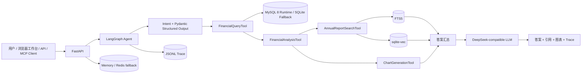

# FinanceInsight Agent

> 基于上市公司财报数据的智能分析 Agent，用于展示 AI 应用开发 / Agent 应用开发岗位所需的端到端工程能力。

## 1. 项目解决什么问题

企业财务分析人员经常需要在结构化指标与年报原文之间来回切换：先查收入、利润、ROE 等数值，再计算同比/CAGR、定位异常年份，最后回到财报正文寻找原因并输出图表。FinanceInsight Agent 将这条链路编排为一个可追踪、可评测、可通过 API/MCP 调用的多工具工作流。

典型问题：

> 分析凯莱英 2022—2024 年营业收入、净利润和 ROE 的变化，如果发现异常年份，结合对应年报分析原因，并生成趋势图和分析报告。

系统会依次完成意图解析、参数白名单校验、财务事实查询、Python 计算、混合检索、图表生成和结果汇总。LLM 只负责理解与表达，不直接生成 SQL，也不直接决定财务数值。

## 2. 架构



LangGraph 节点：

```text
parse → query_sql → [calculate] → [retrieve] → [chart] → synthesize
```

方括号节点由结构化意图中的 `needs_*` 字段条件路由。最大递归步数为 12，工具错误最多尝试 2 次。

## 3. 技术栈与真实用途

| 技术 | 项目中的用途 |
|---|---|
| Python | 数据入库、工具实现、Agent 编排、API、评测与测试 |
| DeepSeek / OpenAI-compatible API | 结构化意图解析与最终自然语言汇总；无 Key 时确定性降级 |
| Pydantic | QueryIntent、ToolResult、API 请求响应与输出校验 |
| SQLite / MySQL | Compose 默认由 MySQL 8 提供在线财务查询；SQLite 是便携数据源和故障降级后端 |
| FTS5 + sqlite-vec | 年报关键词检索、向量检索与 RRF 混合融合 |
| LangGraph | 显式节点、条件边、状态传递、会话检查点与终止控制 |
| FastAPI | 浏览器工作台、同步问答、异步任务、会话、评测、静态图表和健康检查接口 |
| Redis | Compose 中的真实会话/任务存储后端；TTL、AOF 与重启恢复已验证 |
| Matplotlib | 根据已验证序列生成 PNG 图表 |
| MCP | 通过 stdio 暴露财务查询和年报检索工具 |
| Docker Compose | 编排 API、Redis、MySQL；镜像构建、健康检查、服务 DNS 与卷持久化已实测 |
| Pytest + Eval | 单元、集成、E2E、故障注入和小规模评测集 |

## 4. MVP 数据范围

本项目区分两套数据：

- **本地研究数据（默认不公开）**：10 家公司、FY 2022—FY 2024、10 个指标、300 条结构化事实、10 份 2024 年年报、4,178 个切片和 4,178 个向量；是否再分发取决于竞赛规则及原始资料授权。
- **公开合成 Demo（可重复生成）**：沿用相同的 10 个公司标识、3 个年度和 10 个指标，生成 300 条完全虚构的财务事实；另生成 10 篇原创演示经营说明、20 个切片和 20 个 256 维向量。它只用于验证软件链路，不代表任何公司的真实经营数据。

当前向量提供者为 `char-ngram-hashing-v1`，无需下载外部模型，属于可复现基线，不等同于 BGE 语义向量。

## 5. 最快演示：Docker 一键启动

```powershell
docker compose up -d --build
```

等待三个服务 healthy 后打开：

- **用户工作台**：[http://localhost:8000](http://localhost:8000)
- **Swagger API**：[http://localhost:8000/docs](http://localhost:8000/docs)
- **健康检查**：[http://localhost:8000/health](http://localhost:8000/health)

工作台提供问题输入、报告输出、趋势图、结构化意图、年报页码引用、工具调用轨迹、降级提示和 6 题回归评测。Compose 默认使用 MySQL 查询，首次启动会从便携 SQLite 数据源幂等同步 10 家公司、3 个年度、10 个指标、300 条事实；Redis 保存会话和异步任务。

## 6. 本地 Python 启动

### 5.1 安装

```powershell
git clone https://github.com/<你的用户名>/<仓库名>.git
cd <仓库名>
py -3.12 -m venv .venv
Set-ExecutionPolicy -Scope Process Bypass
.\.venv\Scripts\Activate.ps1
python -m pip install --upgrade pip
python -m pip install -e ".[dev,mysql]"
$env:PYTHONPATH = Join-Path $PWD "src"
```

需要 Python 3.11+。首次 clone 后先生成公开合成 Demo 数据：

```powershell
python scripts/init_demo_data.py
```

脚本会创建 `data/finance_insight.sqlite3` 和 `data/rag.sqlite3`。只要其中任一文件已存在，它就会拒绝覆盖；`--force` 仅应在你明确要用合成 Demo 替换现有数据库时使用。真实数据的许可和交付边界见 `docs/DATA_LICENSE.md`。

### 5.2 不使用外部 LLM 的可复现运行

```powershell
python -m finance_insight.cli `
  "分析凯莱英2022—2024年营业收入、净利润和ROE的变化，如果发现异常年份，结合对应年报分析原因，并生成趋势图和分析报告。" `
  --no-llm
```

### 5.3 配置 DeepSeek

密钥只通过环境变量传入，不写入代码或日志：

```powershell
$env:DEEPSEEK_API_KEY = "你的 API Key"
$env:LLM_BASE_URL = "https://api.deepseek.com"
$env:LLM_MODEL = "deepseek-chat"
python scripts/smoke_deepseek.py
```

2026-08-27 已使用真实 Key 跑通单次 API smoke 和完整 Agent 链路，服务端实际返回模型为 `deepseek-v4-flash`，且 `fallback_used=false`。密钥只保存在被 `.gitignore` 排除的 `.env`/进程环境中，不写入示例文件、报告或日志。模型 ID 仍应以账号实际可用能力为准。

5 次小样本基准可运行：

```powershell
python scripts/benchmark_deepseek.py --requests 5 --output data/evaluation/deepseek_benchmark.json
```

## 7. API

启动：

```powershell
python -m uvicorn finance_insight.api:app --host 127.0.0.1 --port 8000
```

同步问答：

```powershell
$body = @{
  question = "查询凯莱英2022到2024年营业收入趋势"
  use_llm = $false
} | ConvertTo-Json
Invoke-RestMethod http://127.0.0.1:8000/v1/query `
  -Method Post -ContentType "application/json" -Body $body
```

主要接口：

- `GET /health`
- `POST /v1/query`
- `POST /v1/tasks`
- `GET /v1/tasks/{task_id}`
- `GET /v1/sessions/{session_id}`

详细契约见 `docs/API.md`。

## 8. MCP

启动 stdio MCP Server：

```powershell
python -m finance_insight.mcp_server
```

暴露工具：

- `financial_query`
- `annual_report_search`

MCP 已通过真实 stdio 子进程完成 initialize、list_tools 和 call_tool 集成测试。

## 9. 测试与评测

```powershell
$env:PYTHONPATH = Join-Path $PWD "src"
python -m compileall -q src tests scripts
python -m pytest -q
python -m finance_insight.evaluation `
  --dataset evals/dataset.json `
  --output data/evaluation/report.json
python scripts/generate_eval_dataset.py
python -m finance_insight.evaluation `
  --dataset evals/dataset_extended_draft.json `
  --output data/evaluation/report_extended_draft.json
```

当前本机结果：

- 30 个测试全部通过；
- 6 条 MVP 基准问题全部成功；
- 意图准确率：1.0；
- 工具选择准确率：1.0；
- SQL 数值 exact match：1.0；
- 引用覆盖率：1.0；
- 任务成功率：1.0；
- 6 条集平均延迟 162.82 ms，P50 69.69 ms，P95 481.88 ms；
- 60 条自动标注初稿也达到 60/60 可执行，平均 61.86 ms，P95 203.53 ms；
- 评测模式：`deterministic-fallback`。

60 条数据的标签状态为 `auto_draft_requires_human_review`，只能作为扩展回归初稿，不能称为人工 gold set。上述结果也不代表生产环境泛化能力。

## 10. Docker

```powershell
Copy-Item .env.example .env
# 在 .env 中填写 DEEPSEEK_API_KEY（也可留空使用 deterministic fallback）
docker compose up -d --build
```

容器启动时若发现两个 SQLite 都不存在，会在 `./data` 自动生成公开合成 Demo；若只存在其中一个，则为避免误覆盖会停止并提示补齐或移走数据库。已有一对真实数据库时不会覆盖。

```powershell
Invoke-RestMethod http://127.0.0.1:8000/health
```

2026-08-27 已真实完成镜像重建并启动 `api`、`redis`、`mysql`，三个服务均为 healthy；API 使用 RedisStore，MySQL 持有 300 条事实且容器重启后数据仍在。API 在线财务查询已使用 MySQL；MySQL 不可用时可显式降级 SQLite，并在 health 与 trace 中暴露原因。详见 `docs/DEPLOYMENT.md`。

## 10. 项目结构

```text
src/finance_insight/
├─ agent/                 # LangGraph state 与 graph
├─ ingestion/             # SQLite/MySQL/RAG/Vector 入库脚本
├─ llm/                   # OpenAI-compatible LLM client
├─ rag/                   # Embedding 与 Hybrid Retriever
├─ tools/                 # SQL/RAG/Analysis/Chart Tools
├─ api.py                 # FastAPI
├─ evaluation.py          # Agent Eval
├─ mcp_server.py          # MCP stdio server
└─ observability.py       # JSONL trace

tests/
├─ unit/
├─ integration/
└─ e2e/
```

## 11. 已验证与未验证边界

**已实际运行：** SQLite 财务查询、MySQL 真实导入与回归、FTS5 + sqlite-vec 混合检索、Python 计算、PNG 图表、LangGraph 多工具链、真实 DeepSeek、FastAPI、Redis TTL/AOF/重启恢复、Docker Compose、MCP stdio、JSONL Trace、30 个测试、6 条固定 Eval 和 60 条自动标注评测初稿。

**尚未完成或仍有限制：** 多进程任务队列、60 条问题人工复核、BGE/FastEmbed 语义向量、Reranker、OCR、真实研报独立数据源、鉴权限流和生产并发压测。DeepSeek 5 次基准只是小样本，不代表生产 SLA。

## 12. 文档导航

- `PROJECT_REQUIREMENTS.md`：需求与业务边界
- `docs/ARCHITECTURE.md`：架构、状态与执行时序
- `docs/API.md`：接口契约
- `docs/DATA_DICTIONARY.md`：数据字典
- `docs/EVALUATION.md`：评测方法和结果
- `docs/DEPLOYMENT.md`：本地与 Docker 部署
- `docs/ADR.md`：关键技术决策
- `docs/PHASE4_22_REPORT.md`：Phase 4—22 实现与学习复盘
- `待补充文档.md`：当前未完成项和后续强化路线

## 14. 人工评测、开源与设备迁移

- `docs/HUMAN_EVALUATION_GUIDE.md`：60 条问题的人工审核标准与 Gold Set 冻结流程；
- `evals/human_review_round1.csv`：已导入 60 条真实 DeepSeek Agent 回答的首轮审核表；
- `docs/OPEN_SOURCE_RELEASE.md`：GitHub 发布、CI、数据许可和“下载可用”方案；
- `docs/DATA_LICENSE.md`：代码许可与第三方/竞赛数据许可的边界；
- `docs/MIGRATION.md`：通过 GitHub + 私有数据包迁移到笔记本；
- `scripts/export_transfer_bundle.ps1` / `scripts/import_transfer_bundle.ps1`：带 SHA256 校验的迁移脚本。

仓库现在已提供无版权风险的合成 Demo 初始化脚本，因此公开 clone 可以完成端到端演示；真实 SQLite、原始资料和首轮人工审核证据仍应保持私有。建议先推送 Private 仓库检查一次，再改为 Public。

