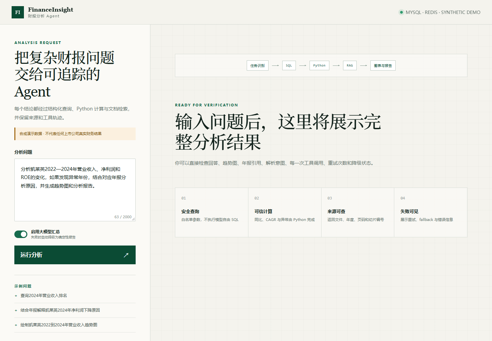
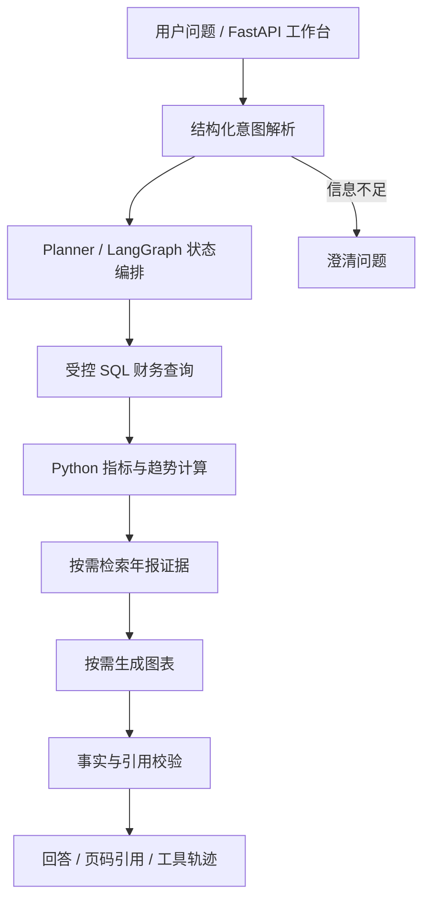
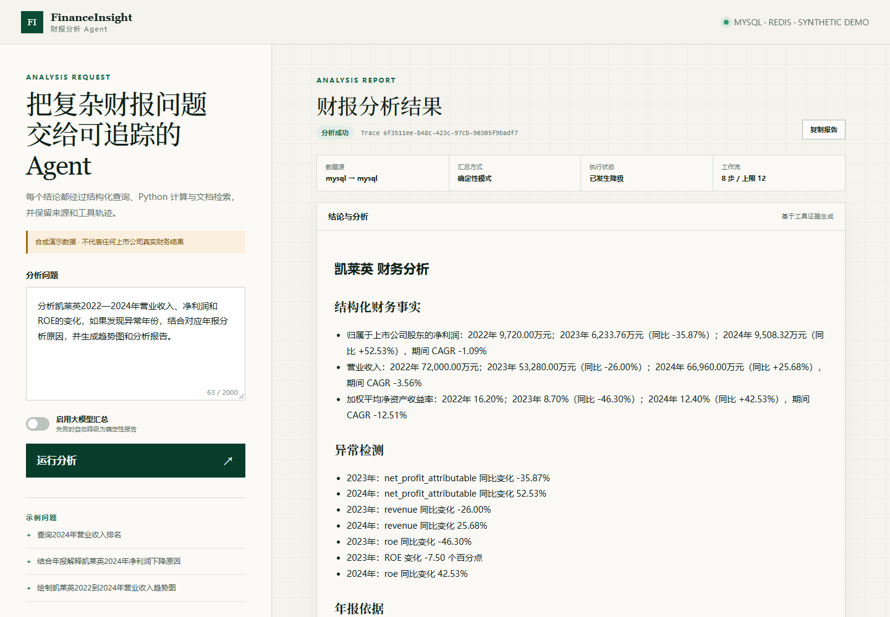
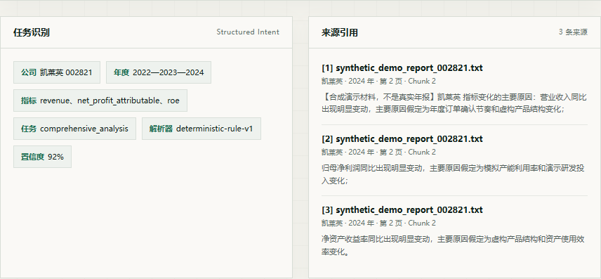

# FinanceInsight Agent

### 可追溯的财报分析与企业知识检索 Agent

[](https://github.com/zhangkai333/finance-insight-agent/actions/workflows/ci.yml)


基于 **Python · FastAPI · LangGraph · SQL · RAG**，把财务分析中的查数、计算、原文检索和报告汇总串成可观察的工具工作流。

面向财务分析师的日常任务：输入一个问题，获得结构化财务数据、确定性计算结果、年报页码引用与执行轨迹。

> **公开仓库默认使用合成 Demo 数据。** 数据覆盖 10 家公司、FY 2022—2024，所有财务数值和说明均为虚构测试内容，不代表任何上市公司真实披露，也不构成投资建议。

> **数字有来源，计算可复核，解释有依据。** SQL 提供财务事实，Python 完成计算，RAG 提供年报证据，LLM 负责理解与表达。

[岗位匹配](#岗位能力匹配) · [个人职责](#个人负责范围) · [快速启动](#快速启动) · [效果截图](#界面与运行效果) · [系统架构](#系统架构) · [验证结果](#验证结果)



## 30 秒读懂项目

| 维度 | 说明 |
|:--- |:--- |
| 用户与问题 | 财务分析需要在数据库、年报原文和多年度指标之间反复核对，普通聊天机器人无法说明数字从哪里来 |
| 核心方案 | `QueryIntent` 结构化问题 → LangGraph 编排 → 受控 SQL 取数 → Python 计算 → SQLite/Chroma RAG 找依据 → 校验与报告 |
| 可验证产出 | 财务事实、同比/CAGR、异常点、文件/页码引用、趋势图、工具调用轨迹、降级原因 |
| 工程化 | 72 个自动化测试、公开回归集 6/6、GitHub Actions、FastAPI、MySQL、Redis、Docker Compose、MCP stdio |
| 安全边界 | 公开仓库使用完全合成数据；真实年报、数据库和 API Key 不进入 Git；系统明确限制为可追溯分析工具，不构成投资建议 |

## 岗位能力匹配

| 目标岗位 | JD 常见关键词 | 本仓库对应证据 |
|:--- |:--- |:--- |
| AI 应用开发工程师 | LLM 应用、结构化输出、工作流编排、Tool Calling、会话、评测、降级 | Pydantic `QueryIntent`、LangGraph 条件路由、多工具调用、有限重试、Trace、6 题回归评测与确定性 fallback |
| RAG 系统工程师 | 文档解析、切分、Embedding、向量检索、BM25、混合召回、Rerank、引用 | 按页切片、公司/年份元数据过滤、SQLite FTS5 + `sqlite-vec`、Chroma + BM25、RRF 融合、重排、文件/页码/chunk 引用 |
| AI 全栈工程师 | 前端、API、异步任务、数据库、缓存、容器化、CI | 响应式 Web 工作台、FastAPI/Swagger、异步评测任务、MySQL、Redis、Docker Compose、GitHub Actions |

这不是“关键词堆砌”表格。每个关键词都能在代码、接口、测试或运行截图中找到对应实现，能力边界统一记录在
[能力矩阵](docs/CAPABILITY_MATRIX.md)。

## 技术栈

| 层级 | 技术 | 在本项目中的用途 |
|:--- |:--- |:--- |
| 前端 | HTML、CSS、原生 JavaScript | 响应式分析工作台、任务状态、证据引用、图表和 Trace 展示 |
| API | FastAPI、Pydantic、Uvicorn | 同步查询、异步任务、会话读取、PDF 导入、Swagger 文档 |
| Agent | LangGraph、Python | 意图解析、任务规划、条件路由、会话状态、校验与降级 |
| 数据 | SQL、SQLite、MySQL 8.4 | 财务事实建模、受控参数化查询、指标口径与来源保存 |
| RAG | FTS5、sqlite-vec、Chroma、BM25、jieba、RRF | 页面级知识库、元数据过滤、混合召回、重排和页码引用 |
| 基础设施 | Redis、Docker Compose、GitHub Actions | 会话缓存、三服务运行、持续集成与公开评测产物 |
| 质量 | pytest、Ruff、JSON 评测集 | 单元、集成、E2E、故障注入和公开回归验证 |

## 解决的业务问题

财务分析师回答一个跨公司、跨年度的问题时，通常需要在财务数据库、年报原文、计算表和图表工具之间反复切换。这个过程容易出现数字复制错误、计算口径不一致、解释丢失页码以及失败被隐藏的问题。

本项目把任务收敛为一条可检查的链路：结构化问题 → 取数 → 计算 → 找证据 → 校验 → 报告。每一层只负责自己擅长的部分，LLM 不直接拥有数据库写权限，也不负责生成财务数字。

| 场景    | 示例                   | 执行方式              |
|:----- |:-------------------- |:----------------- |
| 财务问数  | 2024 年营业收入是多少？       | 结构化意图 → 受控 SQL    |
| 统计分析  | 近三年收入趋势、同比和 CAGR 如何？ | SQL → Python 计算   |
| 多意图查询 | 同时分析营业收入与归母净利润       | 任务规划 → 多指标工具执行    |
| 模糊问题  | 查询某个公司的情况            | 澄清公司、年份或指标        |
| 融合与归因 | 收入和利润发生变化，年报如何解释？    | SQL + 分析 + 年报 RAG |
| 数据校验  | 查询收入并结合年报验证          | 事实覆盖、引用覆盖与计算轨迹检查  |
| 图表报告  | 生成趋势图与分析报告           | 可信序列 → 图表 → 回答汇总  |

## 系统架构



## 项目亮点

- **受控 Agent 编排**：结构化任务计划与条件路由组合查询、分析、检索和图表工具，支持状态管理、有限重试与降级。
- **受控 NL2SQL**：自然语言转查询意图，使用指标白名单和参数化 SQL 查询财务库。
- **企业 RAG**：按页解析、切片、公司/年份过滤、多路召回、重排与引用；默认 SQLite FTS5 + sqlite-vec；可选 Chroma + BM25，本地无 Key 时使用可复现 hashing embedding，配置 Key 后切换 BGE-M3。
- **可信输出**：Pydantic 约束结构化结果，校验事实和引用覆盖；证据不足时返回提示。归因表达为可能原因及年报依据。
- **工程化接口**：FastAPI 同步查询、异步任务、会话结果、工具 Trace、离线 Eval；提供只读 MCP 工具入口。
- **可复现 Demo**：无需私有数据库和 LLM Key，一条 PowerShell 命令即可启动、查询和运行公开评测。

### 会话记忆

- **短期状态记忆**：LangGraph `MemorySaver` 按 `session_id` 保存工作流状态，后续查询可在缺少公司信息时沿用上一轮意图中的公司。
- **会话结果缓存**：内存 Store 或 Redis 保存最近一次同步查询结果，可通过 `GET /v1/sessions/{session_id}` 获取，缓存有效期为 1 小时。
- **自动延续会话**：工作台在浏览器中保存 `session_id`；调用 API 时传入上一轮返回的 `session_id` 即可继续同一会话。

例如，先问 `查询凯莱英2024年营业收入`，再问 `那2023年营业收入呢`，系统可以沿用凯莱英作为查询公司。该连续查询已通过本地接口验证。

当前记忆属于有限的会话上下文继承，不是完整对话推理或长期用户画像。`MemorySaver` 状态在服务重启后丢失；Redis 结果缓存不等同于 LangGraph 检查点持久化。

## 个人负责范围

本项目为个人作品集项目，本人负责应用层从需求到交付的完整实现：

| 模块 | 主要工作 |
|:--- |:--- |
| 产品与数据建模 | 定义财务分析用户任务、指标口径、公司/期间/事实模型以及合成 Demo 数据边界 |
| Agent | 设计 `QueryIntent`、任务计划、LangGraph 节点/条件边、会话继承、校验和降级策略 |
| RAG | 实现页面级切片、元数据过滤、FTS/向量/BM25 召回、融合重排、引用输出和索引验证 |
| 后端 | 实现 FastAPI 查询、异步评测、会话缓存、PDF 导入、健康检查、MCP 工具入口 |
| 前端 | 实现响应式工作台、结构化证据、页码引用、计算过程、图表和工具轨迹展示 |
| 工程化 | 编写测试、故障注入、Demo 初始化、公开评测、CI 和 Docker Compose 运行配置 |

FastAPI、LangGraph、Chroma、Redis 等开源组件作为基础设施使用，核心业务编排、接口契约、数据模型、RAG
流程和前端交互由本人完成。

## 快速启动

公开仓库不包含真实财报数据库。下面的命令会在 `.demo-data/` 中初始化独立合成数据，不会覆盖 `data/`：

```powershell
py -3.12 -m venv .venv
.\.venv\Scripts\python.exe -m pip install -e ".[dev]"
.\scripts\start-demo.ps1
```

如果修改了合成数据生成逻辑，需要刷新 Demo：

```powershell
.\scripts\start-demo.ps1 -RefreshData
```

运行 Chroma + BM25 检索路径：

```powershell
.\.venv\Scripts\python.exe -m pip install -e ".[dev,production-rag]"
.\scripts\start-demo.ps1 -RagBackend chroma
```

也可以手工启动：

```powershell
python scripts/init_demo_data.py --data-dir .demo-data
$env:FINANCE_DB = Join-Path $PWD ".demo-data\finance_insight.sqlite3"
$env:RAG_DB = Join-Path $PWD ".demo-data\rag.sqlite3"
python -m uvicorn finance_insight.api:app --host 127.0.0.1 --port 8000
```

完整容器模式使用 API + MySQL 8.4 + Redis 7：

```powershell
docker compose up -d --build
docker compose ps
```

API 会在命名卷中生成合成 SQLite 数据、同步到 MySQL，并使用 Redis 保存会话结果。数据库端口不暴露到宿主机。

| 入口           | 地址                                                           |
|:------------ |:------------------------------------------------------------ |
| 分析工作台        | [http://127.0.0.1:8000/](http://127.0.0.1:8000/)             |
| Swagger 接口文档 | [http://127.0.0.1:8000/docs](http://127.0.0.1:8000/docs)     |
| 服务健康状态       | [http://127.0.0.1:8000/health](http://127.0.0.1:8000/health) |

**本地查询无需 LLM API Key。** 无 Key 时使用确定性解析与答案模板，保留 SQL、Python 计算、RAG、引用和工具轨迹。接入模型后可使用 LLM 理解与表达能力；PDF 结构化抽取需要有效模型配置。

## 查询示例

可在工作台输入以下问题：

1. `查询凯莱英2024年营业收入`
2. `统计凯莱英2022到2024年营业收入趋势`
3. `分析凯莱英2022到2024年营业收入和归母净利润变化并结合年报解释原因`
4. `请查询某个公司的情况`
5. `核对凯莱英2024年营业收入数据并结合年报验证`

公开合成 Demo 中，第一题输出为 **2024 年营业收入 66,960.00 万元**。趋势问题会进一步返回同比及 CAGR；融合问题附带合成材料页码依据。

通过 Swagger 调用 `POST /v1/query`：

```json
{
  "question": "分析凯莱英2022到2024年营业收入和归母净利润变化并结合年报解释原因",
  "use_llm": false
}
```

除 `answer` 外，可查看 `intent`、`task_plan`、`tool_events`、`citations`、`validation` 和 `execution_context`，了解任务拆解、工具执行及证据校验过程。

## 界面与运行效果

### 完整分析结果

复杂问题返回结构化事实、Python 计算、年报引用、趋势图和执行状态。



### RAG 引用与证据

引用区展示来源文件、公司、年度、页码和 chunk；合成材料会在正文中明确标记为非真实年报。



## 文档导入

```text
文本型 PDF → 按页 Markdown → LLM 结构化 JSON
         → Schema / 指标 / 单位 / 页码校验
         → 财务事实库 + RAG 知识库
```

| 数据                  | 路径                              |
|:------------------- |:------------------------------- |
| 新增财报 PDF            | `data/raw/annual_reports/`      |
| Markdown、JSON 与缓存产物 | `data/processed/pdf_ingestion/` |
| 结构化财务事实库            | `data/finance_insight.sqlite3`  |
| 年报知识库               | `data/rag.sqlite3`              |

在本机 `.env` 配置 OpenAI-compatible API，例如 DeepSeek：

```env
LLM_BASE_URL=https://api.deepseek.com/v1
LLM_API_KEY=your-key
LLM_MODEL=deepseek-chat
```

上传文件（文件名替换为实际文件）：

```powershell
curl.exe -X POST http://127.0.0.1:8000/v1/ingestion/pdf `
  -F "file=@data/raw/annual_reports/002821_2024_annual_report.pdf"
```

服务端先解析 PDF，再把财务相关 Markdown 页发送给模型；使用 SHA-256 去重并保留页码。当前面向正常文本型财报，扫描件 OCR 和复杂表格准确性未验收；本轮未执行真实模型导入联调。API Key 仅放本地 `.env`，不要提交。

## 项目结构

```text
src/finance_insight/
├── agent/          # LangGraph、任务计划、状态、结果校验
├── tools/          # SQL、财务计算、年报检索、图表
├── rag/            # 混合检索、向量接入、重排
├── ingestion/      # PDF → Markdown → JSON → 入库
├── llm/            # OpenAI-compatible 模型客户端
├── web/            # 分析工作台
├── api.py          # FastAPI 与异步任务接口
└── evaluation.py   # 离线回归评测
evals/              # 公开合成回归集与历史评测数据
tests/              # 工具、Agent、API 和导入测试
docs/               # 架构、数据说明与接口文档
```

## 验证结果

| 检查 | 最近可复现结果 |
|:--- |:--- |
| 全量 pytest（含 production-rag） | 72 / 72 passed |
| Ruff | All checks passed |
| 公开合成 Demo 回归集 | 6 / 6 passed |
| HTTP 冒烟检查 | 首页、Swagger、Health 正常；查数、趋势、归因、图表均返回预期状态 |

测试会自动创建临时合成数据库，不读取维护者的私有真实数据库。公开 Demo 评测覆盖问数、趋势、排名、RAG、图表和复合任务；自动评测不代表真实用户泛化准确率。详细说明见 [评测文档](docs/EVALUATION.md)。

```powershell
python -m pytest -q
python -m ruff check src tests scripts
.\scripts\evaluate-demo.ps1
```

提交记录按 `feat`、`fix`、`test`、`style`、`docs`、`chore` 拆分，便于查看从数据、RAG、Agent、API 到部署的演进过程。

## 可选扩展

| 组件                               | 用途              | 接入情况                 |
|:-------------------------------- |:--------------- |:-------------------- |
| DeepSeek / OpenAI-compatible API | 意图理解、结构化抽取、回答表达 | 已接入客户端，按模型配置启用       |
| Chroma + BGE-M3 + BM25           | 向量与词法混合检索       | Chroma + BM25 已验证；BGE-M3 需配置 Key |
| MySQL / Redis                    | 财务存储、会话及任务状态    | Compose 三服务运行态已验证        |
| MCP                              | 对外暴露财务查询与年报搜索工具 | 已接入只读工具服务入口          |
| Docker Compose                   | API + MySQL + Redis | 构建、健康检查、数据同步和查询已验证   |

当前已验证公开合成 Demo 下的 SQLite、SQLite FTS5 + `sqlite-vec`、Chroma + BM25 hashing 检索、MySQL、Redis、FastAPI、MCP stdio 和 Docker Compose 三服务。真实 LLM 与 BGE-M3 需要配置外部 API Key；未配置时分别使用确定性回答和本地 hashing embedding。

向量检索安装方式为 `python -m pip install -e ".[dev,production-rag]"`，配置见 [.env.example](.env.example)。MCP 演示入口为 `python scripts/mcp_client_demo.py`。实际后端与降级信息可通过 `/health` 和工具轨迹查看。

## 延伸阅读

- [架构设计](docs/ARCHITECTURE.md)：模块职责与工作流设计。
- [API 文档](docs/API.md)：查询、任务及导入接口。
- [能力矩阵](docs/CAPABILITY_MATRIX.md)：哪些能力已经实测，哪些仍依赖外部 Key 或环境。
- [作品集评估](docs/PORTFOLIO_REVIEW.md)：从 HR、产品和技术面试官视角给出的可展示结论、追问与改进优先级。
- [面试讲解稿](docs/INTERVIEW_GUIDE.md)：90 秒介绍、演示顺序与高频技术问答。
