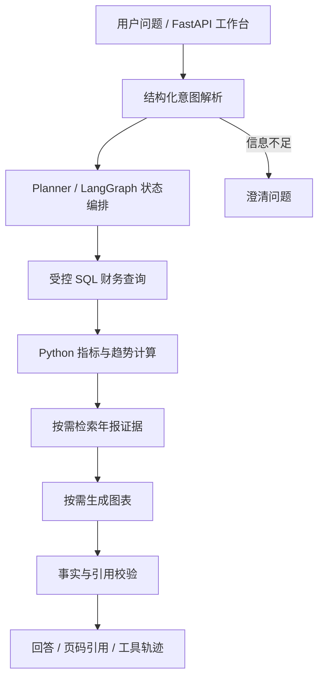

# FinanceInsight Agent

### 可追溯的财报分析与企业知识检索 Agent

基于 **Python · FastAPI · LangGraph · SQL · RAG**，把财务分析中的查数、计算、原文检索和报告汇总串成可观察的工具工作流。

面向财务分析师的日常任务：输入一个问题，获得结构化财务数据、确定性计算结果、年报页码引用与执行轨迹。已有数据覆盖 2022—2024 年，示例公司为凯莱英。

> **数字有来源，计算可复核，解释有依据。** SQL 提供财务事实，Python 完成计算，RAG 提供年报证据，LLM 负责理解与表达。

[快速启动](#快速启动) · [查询示例](#查询示例) · [系统架构](#系统架构) · [文档导入](#文档导入) · [验证结果](#验证结果)

## 能解决什么问题

| 场景    | 示例                   | 执行方式              |
|:----- |:-------------------- |:----------------- |
| 财务问数  | 2024 年营业收入是多少？       | 结构化意图 → 受控 SQL    |
| 统计分析  | 近三年收入趋势、同比和 CAGR 如何？ | SQL → Python 计算   |
| 多意图查询 | 同时分析营业收入与归母净利润       | 任务规划 → 多指标工具执行    |
| 模糊问题  | 查询某个公司的情况            | 澄清公司、年份或指标        |
| 融合与归因 | 收入和利润发生变化，年报如何解释？    | SQL + 分析 + 年报 RAG |
| 数据校验  | 查询收入并结合年报验证          | 事实覆盖、引用覆盖与计算轨迹检查  |
| 图表报告  | 生成趋势图与分析报告           | 可信序列 → 图表 → 回答汇总  |

## 系统架构



### 关键设计

- **受控 Agent 编排**：结构化任务计划与条件路由组合查询、分析、检索和图表工具，支持状态管理、有限重试与降级。
- **受控 NL2SQL**：自然语言转查询意图，使用指标白名单和参数化 SQL 查询财务库。
- **企业 RAG**：按页解析、切片、公司/年份过滤、召回、重排与引用；默认 SQLite FTS5，可选 Chroma + BGE-M3 + BM25 混合检索。
- **可信输出**：Pydantic 约束结构化结果，校验事实和引用覆盖；证据不足时返回提示。归因表达为可能原因及年报依据。
- **工程化接口**：FastAPI 同步查询、异步任务、会话结果、工具 Trace、离线 Eval；提供只读 MCP 工具入口。

### 会话记忆

- **短期状态记忆**：LangGraph `MemorySaver` 按 `session_id` 保存工作流状态，后续查询可在缺少公司信息时沿用上一轮意图中的公司。
- **会话结果缓存**：内存 Store 或 Redis 保存最近一次同步查询结果，可通过 `GET /v1/sessions/{session_id}` 获取，缓存有效期为 1 小时。
- **自动延续会话**：工作台在浏览器中保存 `session_id`；调用 API 时传入上一轮返回的 `session_id` 即可继续同一会话。

例如，先问 `查询凯莱英2024年营业收入`，再问 `那2023年营业收入呢`，系统可以沿用凯莱英作为查询公司。该连续查询已通过本地接口验证。

当前记忆属于有限的会话上下文继承，不是完整对话推理或长期用户画像。`MemorySaver` 状态在服务重启后丢失；Redis 结果缓存不等同于 LangGraph 检查点持久化。

## 快速启动

在项目根目录执行，需 Python 和已有示例数据库：

```powershell
py -m venv .venv
.\.venv\Scripts\Activate.ps1
python -m pip install -e ".[dev]"
if (!(Test-Path .env)) { Copy-Item .env.example .env }
$env:PYTHONPATH = Join-Path $PWD "src"
$env:PYTHONUTF8 = "1"
$env:FINANCE_BACKEND = "sqlite"
$env:RAG_BACKEND = "sqlite"
python -m uvicorn finance_insight.api:app --host 127.0.0.1 --port 8000
```

| 入口           | 地址                                                           |
|:------------ |:------------------------------------------------------------ |
| 分析工作台        | [http://127.0.0.1:8000/](http://127.0.0.1:8000/)             |
| Swagger 接口文档 | [http://127.0.0.1:8000/docs](http://127.0.0.1:8000/docs)     |
| 服务健康状态       | [http://127.0.0.1:8000/health](http://127.0.0.1:8000/health) |

**本地查询无需 LLM API Key。** 无 Key 时使用确定性解析与答案模板，保留 SQL、Python 计算、RAG、引用和工具轨迹。接入模型后可使用 LLM 理解与表达能力；PDF 结构化抽取需要有效模型配置。

## 查询示例

可在工作台输入以下问题：

1. `查询凯莱英2024年营业收入`
2. `统计凯莱英2022到2024年营业收入趋势`
3. `分析凯莱英2022到2024年营业收入和归母净利润变化并结合年报解释原因`
4. `请查询某个公司的情况`
5. `核对凯莱英2024年营业收入数据并结合年报验证`

第一题的本地输出示例：**2024 年营业收入为 580,465.73 万元**。趋势问题会进一步返回同比及 CAGR；融合问题附带年报依据。

通过 Swagger 调用 `POST /v1/query`：

```json
{
  "question": "分析凯莱英2022到2024年营业收入和归母净利润变化并结合年报解释原因",
  "use_llm": false
}
```

除 `answer` 外，可查看 `intent`、`task_plan`、`tool_events`、`citations`、`validation` 和 `execution_context`，了解任务拆解、工具执行及证据校验过程。

## 文档导入

```text
文本型 PDF → 按页 Markdown → LLM 结构化 JSON
         → Schema / 指标 / 单位 / 页码校验
         → 财务事实库 + RAG 知识库
```

| 数据                  | 路径                              |
|:------------------- |:------------------------------- |
| 新增财报 PDF            | `data/raw/annual_reports/`      |
| Markdown、JSON 与缓存产物 | `data/processed/pdf_ingestion/` |
| 结构化财务事实库            | `data/finance_insight.sqlite3`  |
| 年报知识库               | `data/rag.sqlite3`              |

在本机 `.env` 配置 OpenAI-compatible API，例如 DeepSeek：

```env
LLM_BASE_URL=https://api.deepseek.com/v1
LLM_API_KEY=your-key
LLM_MODEL=deepseek-chat
```

上传文件（文件名替换为实际文件）：

```powershell
curl.exe -X POST http://127.0.0.1:8000/v1/ingestion/pdf `
  -F "file=@data/raw/annual_reports/002821_2024_annual_report.pdf"
```

服务端先解析 PDF，再把财务相关 Markdown 页发送给模型；使用 SHA-256 去重并保留页码。当前面向正常文本型财报，扫描件 OCR 和复杂表格准确性未验收；本轮未执行真实模型导入联调。API Key 仅放本地 `.env`，不要提交。

## 项目结构

```text
src/finance_insight/
├── agent/          # LangGraph、任务计划、状态、结果校验
├── tools/          # SQL、财务计算、年报检索、图表
├── rag/            # 混合检索、向量接入、重排
├── ingestion/      # PDF → Markdown → JSON → 入库
├── llm/            # OpenAI-compatible 模型客户端
├── web/            # 分析工作台
├── api.py          # FastAPI 与异步任务接口
└── evaluation.py   # 离线回归评测
evals/              # 固定、silver 与扩展问题集
tests/              # 工具、Agent、API 和导入测试
docs/               # 架构、数据说明与接口文档
```

## 验证结果

| 检查                    | 最近结果                              |
|:--------------------- |:--------------------------------- |
| pytest                | 31 passed                         |
| HTTP 冒烟检查（2026-10-07） | 首页、Swagger、Health 正常；5 条代表性问题符合预期 |
| 固定回归集                 | 5 / 6                             |
| 财务分析 silver 集         | 7 / 7                             |
| 扩展自动初稿                | 58 / 60                           |

评测运行于确定性模式。剩余失败涉及复合任务状态及部分公司的解释引用；自动标签结果不代表真实用户泛化准确率。详细说明见 [评测文档](docs/EVALUATION.md)。

```powershell
python -m pytest -q
python -m finance_insight.evaluation --dataset evals/dataset.json --output data/evaluation/report.json
```

## 可选扩展

| 组件                               | 用途              | 接入情况                 |
|:-------------------------------- |:--------------- |:-------------------- |
| DeepSeek / OpenAI-compatible API | 意图理解、结构化抽取、回答表达 | 已接入客户端，按模型配置启用       |
| Chroma + BGE-M3 + BM25           | 向量与词法混合检索       | 已接入可选检索实现，需安装依赖并建立索引 |
| MySQL / Redis                    | 财务存储、会话及任务状态    | 已接入后端适配，按连接配置启用      |
| MCP                              | 对外暴露财务查询与年报搜索工具 | 已接入只读工具服务入口          |
| Docker Compose                   | API 与配套服务部署     | 已提供容器部署配置            |

上述接入情况描述代码与配置支持，不代表全部组件已通过运行验证。当前已验证的本地运行环境为 SQLite 财务库、SQLite FTS5 RAG 和内存 Store；真实模型、向量检索、MySQL、Redis、MCP stdio 和容器部署尚未完成端到端运行验证。

向量检索安装方式为 `python -m pip install -e ".[dev,production-rag]"`，配置见 [.env.example](.env.example)。MCP 演示入口为 `python scripts/mcp_client_demo.py`。实际后端与降级信息可通过 `/health` 和工具轨迹查看。

## 延伸阅读

- [架构设计](docs/ARCHITECTURE.md)：模块职责与工作流设计。
- [API 文档](docs/API.md)：查询、任务及导入接口。
- 
