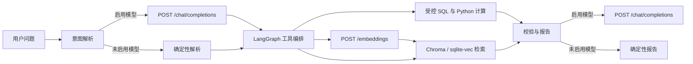

# 模型与 API 接入

本项目提供三种运行模式。默认 Demo 不依赖外部 API；需要展示模型能力时，可以切换到本地
OpenAI-compatible 服务或第三方模型服务。

## 1. 运行模式

| 模式 | 大模型 | Embedding | 是否需要外部 Key | 适用场景 |
|:--- |:--- |:--- |:---: |:--- |
| 默认本地模式 | 确定性解析与报告模板 | `char-ngram-hashing-v1` | 否 | 克隆即运行、CI、无网络面试演示 |
| 本地模型模式 | Ollama 等 OpenAI-compatible 服务 | Ollama BGE-M3 或本地模型 | 否 | 无第三方账单，同时展示真实 HTTP API 调用 |
| 第三方模型模式 | DeepSeek 或任意 OpenAI-compatible 服务 | SiliconFlow BGE-M3、OpenAI 或兼容服务 | 是 | 展示第三方模型 API 集成、模型表达和远程 Embedding |

默认路径始终可用。外部模型是增强项，不是项目启动的硬依赖；调用失败时会保留错误和降级状态，
不会伪造财务事实。

## 2. 调用链



实现位置：

- Chat Completions 客户端：`src/finance_insight/llm/client.py`
- Embedding API 客户端：`src/finance_insight/rag/semantic.py`
- Chroma + BM25 混合检索：`src/finance_insight/rag/chroma_hybrid.py`
- 可选 Chroma 建库脚本：`scripts/index_demo_chroma.py`
- 大模型冒烟脚本：`scripts/smoke_deepseek.py`
- 大模型延迟与成本基准：`scripts/benchmark_deepseek.py`
- 请求格式与重试测试：`tests/unit/test_llm.py`

## 3. 第三方模型 API

项目使用 OpenAI-compatible 协议，不绑定单一供应商。配置只有服务地址、Key 和模型名：

```env
LLM_BASE_URL=https://api.deepseek.com
LLM_API_KEY=your-key
LLM_MODEL=deepseek-chat
```

客户端具备：

- Bearer Token 鉴权；
- `/chat/completions` 请求；
- JSON response format；
- 超时和最多 3 次指数退避重试；
- 模型名与 token usage 读取；
- 未配置 Key 时切换到确定性本地 provider。

其他兼容服务只需替换 `LLM_BASE_URL`、`LLM_API_KEY` 和 `LLM_MODEL`。Key 只放在本地
`.env`，不进入 Git、日志或截图。

## 4. 第三方 Embedding API

配置示例：

```env
EMBEDDING_BASE_URL=https://api.siliconflow.cn/v1
EMBEDDING_API_KEY=your-key
EMBEDDING_MODEL=BAAI/bge-m3
RAG_BACKEND=chroma
```

Embedding 客户端具备：

- `/embeddings` 请求；
- Bearer Token 鉴权；
- 分批（batch）请求；
- 有并发上限的批处理；
- 429 指数退避重试；
- 按返回的 `index` 恢复文本与向量顺序；
- 未配置 Key 时使用可复现本地 hashing embedding。

检索层再把 Embedding 与 BM25 候选做 RRF 融合和重排，最终引用保留公司、年度、文件、页码和
chunk。

## 5. 本地 Ollama 模式

本地 Ollama 也通过 OpenAI-compatible HTTP API 接入，因此面试时仍然可以展示 API 请求能力：

```powershell
ollama pull qwen2.5:7b
ollama pull bge-m3
```

```env
LLM_BASE_URL=http://127.0.0.1:11434/v1
LLM_API_KEY=ollama
LLM_MODEL=qwen2.5:7b

EMBEDDING_BASE_URL=http://127.0.0.1:11434/v1
EMBEDDING_API_KEY=ollama
EMBEDDING_MODEL=bge-m3
RAG_BACKEND=chroma
```

这里的 `ollama` 是本地占位 Key。模型不经过第三方服务，但客户端仍执行真实的 HTTP 请求、
鉴权头、超时和错误处理流程。

## 6. 验证命令

检查大模型链路：

```powershell
python scripts/smoke_deepseek.py --message "请只回复OK"
```

启用远程模型时，结果中的 `fallback_used` 应为 `false`。如果为 `true`，说明没有成功调用
远程模型，而是使用了本地确定性 provider。

检查 Embedding 与 Chroma：

```powershell
python -m pip install -e ".[dev,production-rag]"
python scripts/index_demo_chroma.py
```

启用远程 Embedding 时，结果中的 `embedding_provider` 应显示
`openai-compatible:BAAI/bge-m3`，且 `embedding_fallback` 应为 `false`。

检查延迟、token、成本估算和失败率：

```powershell
python scripts/benchmark_deepseek.py --requests 5
```

## 7. 已验证边界

当前公开仓库已验证：

- 无 Key 的确定性本地链路；
- LLM 请求体、鉴权头、JSON 模式和重试契约的 MockTransport 测试；
- Chroma + BM25 hashing embedding；
- SQLite FTS5 + `sqlite-vec` 本地混合检索。

真实第三方 Chat Completions 和 Embedding 调用需要用户自己的 Key，不会放入 CI。它们已经完成
客户端接入，但不应在未实际调用时宣称“真实 API 已端到端验收”。

## 8. 安全要求

- 只使用本地 `.env` 或部署平台 Secret；
- 不把 Key 写入 README、截图、Trace、Issue 或 Git；
- Key 一旦公开，立即在供应商控制台撤销并重新创建；
- 第三方调用应设置预算、超时和并发上限；
- 演示数据仍保持合成标记，不因切换模型而变成真实财务数据。
