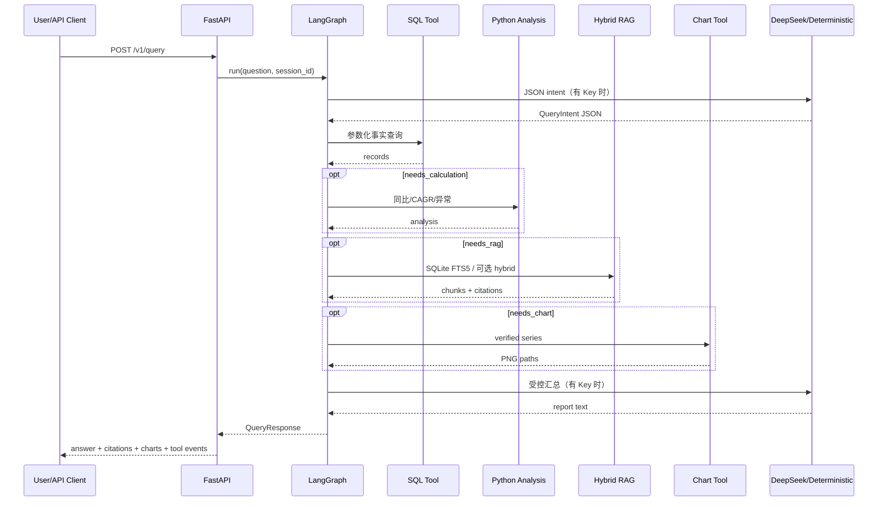

# Architecture

## 1. 设计原则

1. **事实与生成分离**：SQL Tool 查询的财务事实、Python Tool 的计算结果和 RAG Tool 的原文片段是结论依据；LLM 不拥有直接访问数据库或执行自由 SQL 的权限。
2. **先结构化、后编排**：问题先落到 `QueryIntent`，再由 `needs_sql`、`needs_rag`、`needs_calculation` 和 `needs_chart` 决定路径。
3. **每一步可观察**：每个工具调用都记录 `trace_id`、状态、耗时、错误和重试次数到 JSONL。
4. **可降级而不编造**：LLM、Redis、向量索引等外围能力失败时，系统回退到确定性解析、内存存储或 FTS5，但不伪造数据。
5. **MVP 数据边界显式化**：仅覆盖当前入库的 10 家公司、FY 2022—2024 和 10 份 2024 年报。

## 2. 运行时组件

| 组件 | 职责 | 输入 | 输出 |
|---|---|---|---|
| FastAPI + Web Workspace | 输入/输出 UI、HTTP、图表与评测 | 浏览器 / `QueryRequest` | 页面、`QueryResponse` / task 状态 |
| FinanceInsightAgent | 编排节点和处理失败 | question、session | 答案、图表、引用、轨迹 |
| Intent Parser | 解析公司、年份、指标、需求 | 自然语言 | `QueryIntent` |
| FinancialQueryTool | MySQL/SQLite 双后端白名单参数化 SQL | `QueryIntent` | 财务事实 records + backend/fallback metadata |
| FinancialAnalysisTool | 同比、CAGR、异常 | records | 序列、异常点 |
| AnnualReportSearchTool | 年报混合检索 | intent、query | chunks、页码引用 |
| ChartGenerationTool | 画已验证序列 | analysis series | PNG；API 映射为 `/artifacts/*` |
| LLM Client | JSON 模式解析/受控表达 | messages | `LLMResponse` |
| Store | 会话和异步任务 | key/value | memory 或 Redis |
| JsonlTracer | 事件轨迹 | trace payload | `agent_trace.jsonl` |

## 3. LangGraph State

`AgentState` 在图内传递，不允许各节点通过隐式全局变量交换核心业务信息：

| 字段 | 用途 |
|---|---|
| `question` | 原始用户问题 |
| `trace_id` | 单次执行的全局关联 ID |
| `session_id` | LangGraph checkpointer / API 会话关联 ID |
| `intent` | 结构化意图 |
| `financial_data` | SQL Tool 的可信事实 |
| `calculations`、`anomalies` | Python 计算的可复核结果 |
| `rag_chunks`、`citations` | RAG 文本与页码引用 |
| `chart_paths` | 生成的 PNG 文件 |
| `tool_events` | 工具级状态、耗时、重试 |
| `errors`、`fallback_used` | 部分成功、降级和失败解释 |
| `step_count` | 防止不可控循环的辅助状态 |

`MemorySaver` 以 `session_id` 作为 `thread_id` 保存图状态。后续问题未写公司名时，解析节点可以读取上一轮 intent 的公司上下文；但不会用历史上下文替换用户明确指定的新公司或新年份。

## 4. 执行时序

## 5. Tool Routing

| 用户意图 | 需要的工具 | 原因 |
|---|---|---|
| “查询某公司收入” | SQL | 指标是结构化事实 |
| “分析趋势/同比/CAGR/异常” | SQL + Python Analysis | 数值先可信查询，再确定性计算 |
| “为什么下降/年报依据” | SQL + Python + RAG | 年报原文用于解释而非替代数值 |
| “生成趋势图” | SQL + Python + Chart | 图表只能基于计算后的可信序列 |
| “综合分析报告” | SQL + Python + RAG + Chart + LLM | 多来源证据汇总 |

## 6. RAG 检索设计

默认 `RAG_BACKEND=sqlite`：SQLite FTS5 词法召回、公司/报告年度过滤、词法与元数据重排，返回文件、页码、chunk 和实际检索模式。可选本地 hashing embedding + `sqlite-vec` + RRF；可选 `RAG_BACKEND=chroma`：OpenAI-compatible/BGE-M3 embedding、Chroma 向量召回、jieba BM25 融合。后两种路径依赖环境与索引，本机本轮未完成外部依赖的实测。缺依赖或索引时降级 FTS5/LIKE，并在响应和 trace 标明原因。最多两轮检索，记录候选数和证据分数；证据分数不等于引用真实性人工评审。

新 PDF 链路：文本解析/表格提取 → 按页 Markdown → 缓存和切片 → LLM 提议结构化 JSON → schema、白名单、单位/页码校验 → 财务 SQLite 与 RAG SQLite；Chroma 增量写入为可选步骤。扫描件 OCR、复杂表格的逐项核对及真实 DeepSeek happy path 尚未在当前机器验收。

## 7. 可靠性与安全边界

- LLM HTTP 调用：最多 3 次请求重试；
- Tool：失败时最多执行 2 次；
- Graph：`recursion_limit=12`；
- SQL：仅使用项目构造的参数化查询，LLM 不传递 SQL 文本；
- 密钥：仅使用环境变量，Trace 日志过滤名称含 `key` 或 `authorization` 的字段；
- RAG：引用携带来源页码；
- 外部依赖：LLM/Redis/向量层不可用时都有明确 fallback 标志。

## 8. 生产化演进

- Compose 在线查询已由 SQLite 演进到 MySQL 8；SQLite 保留为便携数据源与错误降级；
- 内存 Store → Redis；
- hashing embedding → BGE/托管 embedding；
- 词法重排 → 真实语义 reranker 与带人工标签的召回评测；
- ThreadPoolExecutor → Celery/RQ/消息队列；
- JSONL → OpenTelemetry + 集中式日志/Trace 平台；
- 增加鉴权、RBAC、限流、成本监控和线上评测回流。

## 9. 数据后端与故障降级

本地默认财务查询使用 SQLite；Compose 配置支持 `portable SQLite → 启动同步 → MySQL 8 → FinancialQueryTool`，但本轮未运行 Docker/MySQL。`ping()` 与 SQL tool event 记录 requested/effective backend；允许回退时明确展示原因。RAG 使用独立 SQLite 检索库，默认实际路径是 FTS5；它不是财务事实查询后端。
